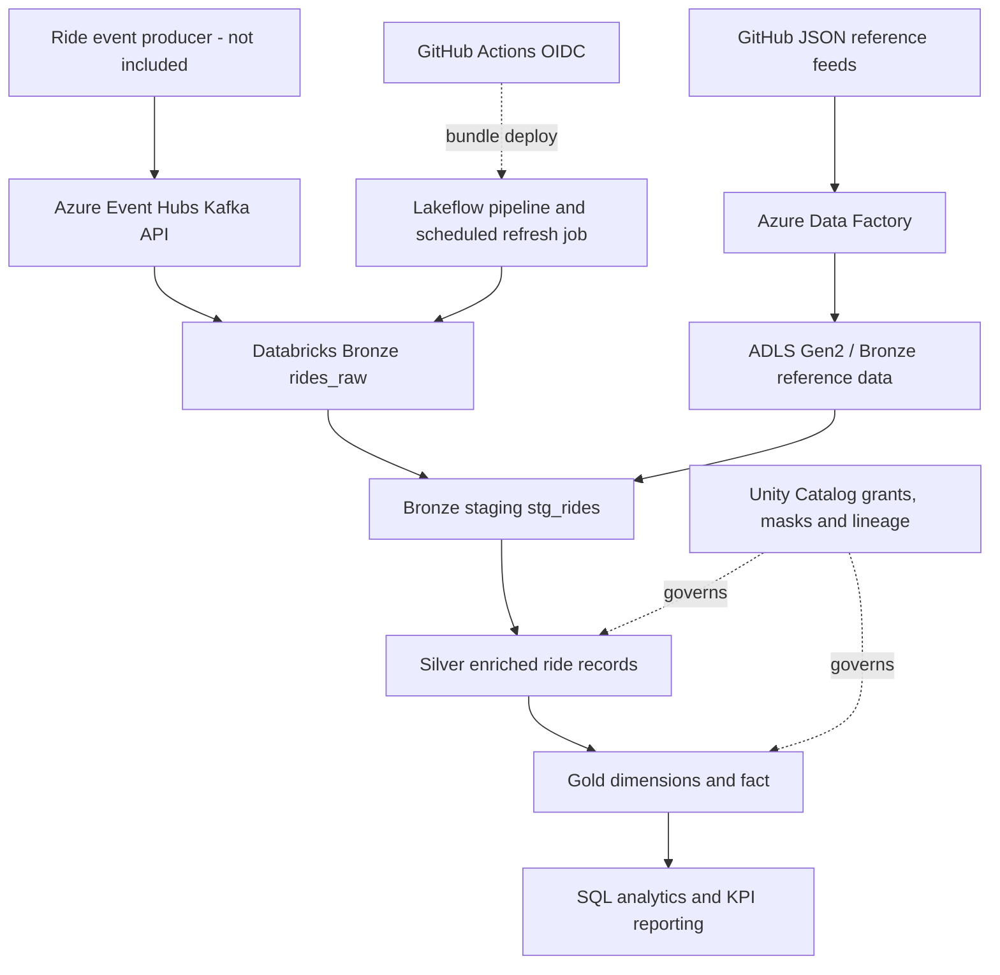

# ADR-001 | Hybrid Uber ride analytics: architecture and trade-offs

Status: design documented; pipeline source committed; live Azure deployment and operational results still to be verified.

## Decision
Use **Azure Data Factory -> ADLS Gen2** for low-frequency batch/reference inputs and **Azure Event Hubs' Kafka-compatible endpoint -> Spark Structured Streaming** for ride events. Use **Lakeflow Declarative Pipelines (Delta Live Tables)** to express Bronze, Silver and Gold transformations, with **Unity Catalog** for access control and lineage. Gold includes SCD1 dimensions plus an SCD2 location dimension.

## Architecture

## Why Lakeflow rather than standalone Spark jobs?
Declarative dependencies, managed update lifecycle and operational event logs reduce orchestration code. Trade-offs include workspace/runtime feature coupling and careful CDC sequencing; custom jobs offer more execution control.

## Why Event Hubs rather than self-managed Kafka?
Azure-managed ingestion avoids broker operations; the Kafka protocol allows Spark's native Kafka source. Trade-offs: throughput units/cost, partition design, Azure-specific authentication and message retention.

## Why SCD Type 2 for locations?
Changes to city and region attribution should retain historical versions for time-correct ride analytics. Use SCD1 for mutable attributes when historical values have no reporting value. Ensure SCD2 sequencing uses reliable event/update timestamps, not arbitrary IDs.

## Operational controls to verify on Azure
- Check Kafka partitions, offsets, consumer lag, checkpoint persistence, malformed-event DLQ and restart recovery.
- Reconcile event counts between Bronze, Silver and Gold; track late/invalid event metrics.
- Enforce schema quality rules, report accepted/rejected counts, and verify idempotent replay.
- Compare streaming costs on serverless vs sized classic clusters with measured DBUs.
- Validate alerts, schedule, production RBAC, lineage and masking using test identities.

## Known repository integration blockers
The current transformations contain hardcoded catalog identifiers, Event Hubs namespace/hub names, inconsistent output qualification, CDC sequencing choices that need review, and a misspelled ADLS folder (`igestion`). The ADF lookup and target paths must match. Fix these with actual workspace details before deploying. Do not infer successful cloud execution from this ADR.
